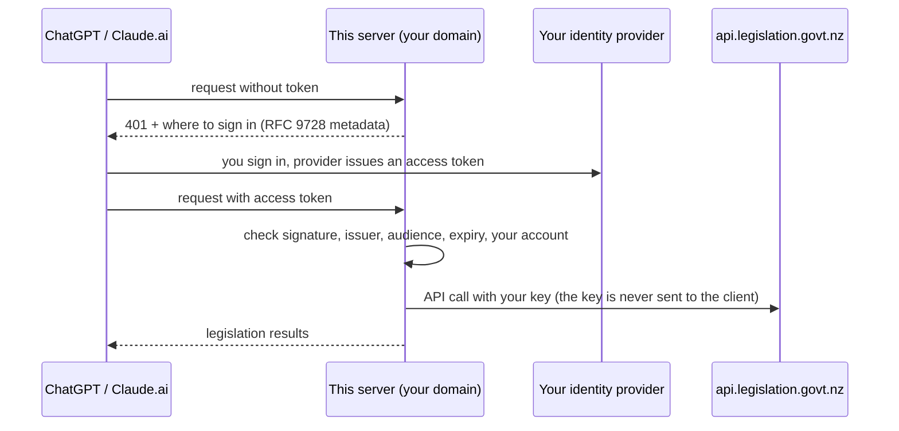

# Self-hosting a remote endpoint

Most people should run this server locally (stdio). Claude Desktop, Claude Code, Codex, Cursor and VS Code all support that, and nothing is exposed to the internet. See the README.

A remote endpoint is only needed for clients that cannot start a local program: ChatGPT, Claude on the web or mobile, and the xAI (Grok) API. This guide covers that.

> Not an official Parliamentary Counsel Office (PCO) product. Results are not legal advice; check the official version on legislation.govt.nz.

## How it works and why it is locked down

- The server holds your Legislation API key. The PCO API terms of use (clause 6, read 2 November 2026) say you must not share your key with, or let it be used by, anyone else. A remote endpoint must therefore admit only you.
- Sign-in uses OAuth 2.1 through an identity provider you control (for example Auth0 or Keycloak). This server never sees passwords. It checks the signed access tokens your provider issues, and admits only the account(s) listed in `LEGISLATION_NZ_OAUTH_ALLOWED_SUBJECTS`.
- Without OAuth, the server refuses to start when it is bound to a non-loopback address, or when a public URL is set. Without OAuth it answers only requests addressed to `localhost`.
- Other protections: Host and Origin checks, per-user and per-IP rate limits, request-size limits, security headers, no JSON-RPC batches, and a non-root, read-only container.

> Warning: never put a tunnel or proxy that rewrites the Host header to `localhost` (for example `ngrok --host-header=rewrite`, or a cloudflared `httpHostHeader` setting) in front of a server running without OAuth. The server cannot tell such traffic apart from local use, and would serve it without sign-in.



## What you need

1. A Legislation API key (request one by email to contact@pco.govt.nz; see https://www.legislation.govt.nz/developer-api/).
2. A domain name for the server, for example `mcp.example.com`. The Caddy example below obtains HTTPS certificates automatically.
3. Somewhere to run containers (a small virtual machine or container host).
4. An identity provider account. See [Choosing a provider](#choosing-a-provider).

## Quick start with Docker Compose and Caddy

`deploy/docker-compose.yml` runs the server behind [Caddy](https://caddyserver.com), which terminates TLS with automatic certificates. It runs a published image pinned by digest (see [Using a published image](#using-a-published-image)). To build from this repository instead, add the build override `deploy/docker-compose.build.yml`; the main file has no build section, so a verified image is never replaced by a local build.

1. Copy the repository (or at least `deploy/`, and for a source build also `Dockerfile` and the source) to your server.
2. Put your API key in `deploy/secrets/legislation_api_key` (one line), then make it readable only by the container's user (uid 65532):

   ```sh
   sudo chown 65532:65532 deploy/secrets/legislation_api_key
   sudo chmod 400 deploy/secrets/legislation_api_key
   ```

   Do not use `chmod 644` to get around a "cannot be read" error: that makes your key readable by every account on the machine.

3. Copy `deploy/.env.example` to `deploy/.env` and fill in your domain and provider values (see [Configuration](#configuration)).
4. Point your domain's DNS at the server, then, in `deploy/`, start it:
   - Published image (set `NZLM_IMAGE` in `deploy/.env` to a verified digest first): `docker compose pull && docker compose up -d`
   - Built from source: `docker compose -f docker-compose.yml -f docker-compose.build.yml up -d --build`

   Caddy starts once the server passes its container health check, which connects to `127.0.0.1` inside the container. If you set `LEGISLATION_NZ_HTTP_HOST` to a specific address instead of the default `0.0.0.0`, the check cannot connect and Caddy will not start: keep the default in the container.

5. Check that `https://mcp.example.com/healthz` returns `{"status":"ok"}`, and that `https://mcp.example.com/.well-known/oauth-protected-resource/mcp` names your provider.

The key is passed as a Docker secret file, so it does not appear in environment variables or `docker inspect`.

### Using a published image

Release images are published (from 1.0.1) to `ghcr.io/thatskiff33/nz-legislation-mcp` for `linux/amd64` and `linux/arm64` (each built on a native runner and scanned), signed with Sigstore cosign (keyless), with an SBOM and build provenance.

To use one:

1. Look up the digest of the version you want, then verify the signature of that digest. Releases are signed by this repository's `container.yml` workflow, run from `main` by the release workflow. Use cosign v3 or later. Releases are signed with cosign v3, and on 7 November 2026 cosign v2.4.1 reported "no signatures found" for 1.0.1, while v3.0.2 and v3.1.4 verified it.

   ```sh
   digest="$(docker buildx imagetools inspect ghcr.io/thatskiff33/nz-legislation-mcp:1.0.1 \
     --format '{{json .Manifest}}' | jq -r .digest)"
   cosign verify "ghcr.io/thatskiff33/nz-legislation-mcp@$digest" \
     --certificate-oidc-issuer https://token.actions.githubusercontent.com \
     --certificate-identity https://github.com/thatskiff33/nz-legislation-mcp/.github/workflows/container.yml@refs/heads/main
   ```

   The identity is the workflow file and the branch it ran from (`job_workflow_ref`). On 1.0.1 this command passed (cosign v3.1.4, 7 November 2026, recorded on #11), and the same command with a different workflow in the identity failed. If verification fails on the identity, cosign's error (v3.1.4) names the identity it found (`expected SAN value "...", got "..."`); report that value.

2. Set `NZLM_IMAGE` in `deploy/.env` to that digest, for example `ghcr.io/thatskiff33/nz-legislation-mcp:1.0.1@sha256:<digest>`. A tag can later be moved; a digest cannot. Never use an unpinned `latest`.

### Running the container without Compose

```sh
docker build -t nz-legislation-mcp .
docker run -d --name nz-legislation-mcp \
  --read-only --cap-drop ALL --security-opt no-new-privileges \
  -p 127.0.0.1:8080:8080 \
  -v "$PWD/deploy/secrets/legislation_api_key:/run/secrets/legislation_api_key:ro" \
  -e LEGISLATION_NZ_API_KEY_FILE=/run/secrets/legislation_api_key \
  -e LEGISLATION_NZ_PUBLIC_URL=https://mcp.example.com/mcp \
  -e LEGISLATION_NZ_OAUTH_ISSUER=https://YOUR-PROVIDER/ \
  -e LEGISLATION_NZ_OAUTH_ALLOWED_SUBJECTS=YOUR-ACCOUNT-ID \
  nz-legislation-mcp
```

Put an HTTPS reverse proxy in front of port 8080. Pass the original `Host` header through unchanged (the server checks it against `LEGISLATION_NZ_PUBLIC_URL`). If the proxy appends the client address to `X-Forwarded-For`, set `LEGISLATION_NZ_TRUST_PROXY=true` so per-IP limits apply to real clients rather than to the proxy.

### Behind an existing reverse proxy

If you already run a reverse proxy that handles HTTPS, for example on another machine, you can use it instead of the bundled Caddy (tested 8 November 2026, #11):

- Terminate TLS at the proxy. The public URL must still be `https://`, and `LEGISLATION_NZ_PUBLIC_URL` must match it exactly.
- Pass the original `Host` header through unchanged. The server checks it and answers 403 "Invalid Host" if it changes.
- Forward every path to the server, including `/.well-known/oauth-protected-resource/mcp` (sign-in discovery) and `/healthz`.
- Publish the server's port only on a private-network address the proxy can reach, never on a public address, and allow only the proxy to connect to it. A host firewall such as ufw does not filter ports that Docker publishes (Docker's documentation says the traffic is routed before ufw's rules apply), so use a firewall in front of the host or follow Docker's firewall guidance.
- Keep `LEGISLATION_NZ_TRUST_PROXY=true` (the Compose file sets it) if the proxy appends the client address to `X-Forwarded-For`. This is safe only while nothing but the proxy can reach the server. A client that could connect directly could put any address in that header and get around the per-IP limits.

To turn off the bundled Caddy and publish the port, create `deploy/docker-compose.override.yml`, with `PRIVATE-IP` replaced by the server's private-network address:

```yaml
services:
  mcp:
    ports: ["PRIVATE-IP:8080:8080"]
    # Rotate the container's logs (many hosts have no Docker-wide log limit).
    logging:
      driver: json-file
      options:
        max-size: "10m"
        max-file: "3"
  caddy:
    profiles: ["disabled"]
```

Docker Compose reads `docker-compose.override.yml` automatically, so start the server as usual with `docker compose pull && docker compose up -d`. (Compose skips it when files are named with `-f`, so if you build from source, add `-f docker-compose.override.yml` to that command.) A service with a profile only starts when that profile is requested, so Caddy stays off. Keep `NZLM_DOMAIN` in `.env`, because the server's public URL is built from it.

#### Starting after the private network on reboot

Docker can only publish the port on a specific address once that address exists. If the address belongs to a VPN or overlay interface that comes up after Docker at boot, the container may fail to start. Docker's service already waits for the network to be online, so you only need to order it after the interface's service. Run `sudo systemctl edit docker.service` and add, with `YOUR-VPN.service` replaced by that service (for example `wg-quick@wg0.service` for WireGuard or `tailscaled.service` for Tailscale):

```ini
[Unit]
Wants=YOUR-VPN.service
After=YOUR-VPN.service
```

Then reboot and check that the server comes back on its own (`docker compose ps` in `deploy/`).

## Configuration

All settings are environment variables. The server checks them at start-up and exits with a clear message if anything is wrong or unsafe.

| Variable                                | Required         | Default                                  | Meaning                                                                                                                                                                                            |
| --------------------------------------- | ---------------- | ---------------------------------------- | -------------------------------------------------------------------------------------------------------------------------------------------------------------------------------------------------- |
| `LEGISLATION_NZ_API_KEY`                | One of these two |                                          | Your Legislation API key.                                                                                                                                                                          |
| `LEGISLATION_NZ_API_KEY_FILE`           | One of these two |                                          | Path to a file holding the key (preferred in containers).                                                                                                                                          |
| `LEGISLATION_NZ_PUBLIC_URL`             | Remote           |                                          | Public URL of the endpoint, ending in `/mcp`, for example `https://mcp.example.com/mcp`. It is also the token audience.                                                                            |
| `LEGISLATION_NZ_OAUTH_ISSUER`           | Remote           |                                          | Your provider's issuer, exactly as it appears in tokens (`iss`). Copy the `issuer` value from your provider's discovery document (`.../.well-known/openid-configuration`).                         |
| `LEGISLATION_NZ_OAUTH_ALLOWED_SUBJECTS` | Remote           |                                          | Comma-separated account IDs (`sub` claim) allowed in: you.                                                                                                                                         |
| `LEGISLATION_NZ_OAUTH_AUDIENCE`         | No               | the public URL                           | Expected token audience, if your provider cannot use the URL. Use a value unique to this server.                                                                                                   |
| `LEGISLATION_NZ_OAUTH_JWKS_URL`         | No               | discovered                               | Signing-key URL, if your provider's metadata has none. Must be https.                                                                                                                              |
| `LEGISLATION_NZ_OAUTH_REQUIRED_SCOPES`  | No               | none                                     | Scopes every token must carry, space or comma separated.                                                                                                                                           |
| `LEGISLATION_NZ_OAUTH_REQUIRE_AT_JWT`   | No               | `false`                                  | `true` to require the RFC 9068 `at+jwt` token type (if your provider sets it). Only `true` or `false` (any case); other values stop start-up.                                                      |
| `LEGISLATION_NZ_HTTP_HOST`              | No               | `127.0.0.1` (`0.0.0.0` in the container) | Address to listen on.                                                                                                                                                                              |
| `LEGISLATION_NZ_HTTP_PORT`              | No               | `8080`                                   | Port to listen on.                                                                                                                                                                                 |
| `LEGISLATION_NZ_TRUST_PROXY`            | No               | `false`                                  | `true` when a reverse proxy in front of the server appends the client address to `X-Forwarded-For` (the Compose example sets this). Only `true` or `false` (any case); other values stop start-up. |
| `LEGISLATION_NZ_ALLOWED_ORIGINS`        | No               | none                                     | Browser origins (hostnames) allowed to call the endpoint directly. Not needed for ChatGPT or Claude, which call from their servers.                                                                |
| `LEGISLATION_NZ_RATE_LIMIT_PER_MINUTE`  | No               | `60`                                     | Requests per minute per signed-in user. Public routes and failed sign-ins are limited per IP address at five times this.                                                                           |
| `LEGISLATION_NZ_TIMEOUT_MS`             | No               | `15000`                                  | Timeout for each Legislation API request.                                                                                                                                                          |
| `LEGISLATION_NZ_CACHE`                  | No               | `off`                                    | `memory` to cache API responses and rendered text in memory. Off until the PCO confirms caching is allowed.                                                                                        |
| `LEGISLATION_NZ_LOG_LEVEL`              | No               | `info`                                   | `debug`, `info`, `warn` or `error`. Logs go to stderr as JSON lines, with your key redacted.                                                                                                       |

## Choosing a provider

Your provider must issue JWT access tokens whose audience is this server, and must let ChatGPT or Claude register as a client. Client support differs:

| Provider | ChatGPT                                                                                                                | Claude Desktop and Code    | Claude on the web                               | Notes                                                                                                          |
| -------- | ---------------------------------------------------------------------------------------------------------------------- | -------------------------- | ----------------------------------------------- | -------------------------------------------------------------------------------------------------------------- |
| Auth0    | Yes, via dynamic client registration                                                                                   | Yes                        | Yes                                             | Hosted; free tier available. Recipe below; tested end to end with ChatGPT on 8 November 2026 (Google sign-in). |
| Keycloak | Not via Client ID Metadata Documents (Keycloak's guide describes a custom workaround); dynamic registration not tested | Yes (per Keycloak's guide) | Expected (same callback as Desktop; not tested) | Self-hosted, open source. Recipe below; token checks tested.                                                   |

Other providers can work if they meet the requirements above, because the server is a standard OAuth 2.1 resource server.

### Recipe: Keycloak (Claude clients)

The maintainers checked this recipe's token handling on 2 November 2026 with Keycloak 26.4.5. A token for the configured user was accepted; a valid token for a different user got 403; a missing or tampered token got 401. You can repeat the check with `scripts/keycloak-check.sh`. The interactive sign-in from a Claude client has not been tested by the maintainers; follow Keycloak's guide for that part.

1. In a realm (for example `nzlm`), create your user.
2. Create a client scope with an "Audience" mapper whose "Included Custom Audience" is your `LEGISLATION_NZ_PUBLIC_URL` (for example `https://mcp.example.com/mcp`), added to the access token. Make it a realm "Default" client scope, so clients that register themselves get it without asking for it.
3. Set up client registration for the Claude client you use (Client ID Metadata Documents, or anonymous dynamic registration) following [Keycloak's MCP guide](https://www.keycloak.org/securing-apps/mcp-authz-server). It lists the client-policy settings for Claude Code and Claude Desktop. Its Client ID Metadata Document support is an experimental feature (`--features=cimd`); check that your Keycloak version has it.
4. Configure this server:
   - `LEGISLATION_NZ_OAUTH_ISSUER`: the `issuer` from `https://keycloak.example.com/realms/nzlm/.well-known/openid-configuration` (usually the realm URL).
   - `LEGISLATION_NZ_OAUTH_ALLOWED_SUBJECTS`: your user's ID (Users, select the user, copy "ID"; it is the token's `sub`).

### Recipe: Auth0 (ChatGPT and Claude)

Tested end to end with ChatGPT on 8 November 2026, signing in through a Google social connection (#11). Claude clients have not been tested with this recipe. The Auth0 and Google dashboards change over time; the notes say what they showed on 8 November 2026.

1. Create an "API" whose "Identifier" is your `LEGISLATION_NZ_PUBLIC_URL` (for example `https://mcp.example.com/mcp`). Auth0 then issues JWT access tokens with that audience.
2. On that API, set "Default permissions for third-party applications" (user-delegated access) to "Authorized". Do this before step 3. Clients that register themselves are third-party applications, and Auth0's documentation says they get no access to an API without default permissions.
3. In tenant "Settings", "Advanced", turn on "Dynamic Client Registration" so ChatGPT and Claude can register themselves. Check that the "Resource Parameter Compatibility Profile" is on, so the MCP `resource` parameter is used as the audience (it was already on in a new tenant). Older guidance mentions a "Strict" security mode for registration; the dashboard did not offer one, only a warning that registration is open.
4. Set up the connection you will sign in with, and turn on "Promote Connection to Domain Level" for it. Clients that register themselves can only use domain-level connections.
   - Google (tested):
     - In Google Cloud, create your own OAuth client of type "Web application", with the authorised JavaScript origin `https://YOUR-AUTH0-DOMAIN` and the authorised redirect URI `https://YOUR-AUTH0-DOMAIN/login/callback`. On Google's "Branding" page, add `auth0.com` under "Authorised domains".
     - In Auth0's Google connection, enter that client's ID and secret, set "Purpose" to "Authentication", and leave "Offline Access" off. Don't use Auth0's development keys, which Auth0 says are not for production.
     - As an extra lock, leave the Google app's publishing status at "Testing", with only your own Google account as a test user, so Google itself refuses other accounts. Testing status is fine for sign-in, because Auth0 does not ask Google for offline access.
   - Username and password (not tested end to end): create your user, then turn on "Disable Sign Ups" for the connection.
5. Find your account's user ID (User Management, Users, your user). It looks like `google-oauth2|...` for Google, or `auth0|...` for a username-and-password user.
6. Configure this server:
   - `LEGISLATION_NZ_OAUTH_ISSUER`: the `issuer` from `https://YOUR-AUTH0-DOMAIN/.well-known/openid-configuration` (for Auth0 it normally ends with a slash).
   - `LEGISLATION_NZ_OAUTH_ALLOWED_SUBJECTS`: your user ID only.

Anyone can register a client with your tenant, and the Google connection had no setting to stop new accounts signing up. `LEGISLATION_NZ_OAUTH_ALLOWED_SUBJECTS` is therefore the control that admits only you: the server refuses a valid sign-in by any other account with 403.

Auth0 also offers Client ID Metadata Document (CIMD) registration as a separate setting, which ChatGPT prefers where available. It could replace open dynamic registration, but it has not been tested with this server.

## Connecting clients

- **ChatGPT:** add a custom MCP connector with the URL `https://mcp.example.com/mcp`. Where to add it depends on your plan and ChatGPT's current settings. In a ChatGPT Business workspace on 8 November 2026, it was added from "Plugins", then "Add", then "Add custom MCP server", and the final button was "Create as a plugin" (as reported by the owner). Other plans may differ. ChatGPT discovers your provider from this server, then asks you to sign in. ChatGPT prioritises Client ID Metadata Documents when available and otherwise can use dynamic client registration ([OpenAI documentation](https://developers.openai.com/plugins/build/auth)).
- **Claude (web, Desktop):** add a custom connector with the same URL. Claude supports dynamic client registration and Client ID Metadata Documents ([Anthropic documentation](https://claude.com/docs/connectors/building/authentication)).
- **xAI (Grok) API:** the API can call remote MCP servers and lets you supply an `authorization` value, which it sends in the Authorization header ([xAI documentation](https://docs.x.ai/developers/tools/remote-mcp)). Because this server accepts only short-lived OAuth access tokens, you would obtain a fresh token from your provider for each session. Whether xAI expects the `Bearer ` prefix in that value is to confirm. There is no long-lived key option, by design.

## Troubleshooting

| Symptom                                               | Likely cause                                                                                                                              |
| ----------------------------------------------------- | ----------------------------------------------------------------------------------------------------------------------------------------- |
| Server exits at start-up with "Invalid configuration" | Read the listed problems; each names the variable to fix.                                                                                 |
| "points to a file that cannot be read"                | The key file is not readable by uid 65532. See step 2 of the quick start.                                                                 |
| `401` with `invalid_token`                            | Wrong issuer or audience, an expired token, or a token from a different provider. Compare the token's `iss` and `aud` with your settings. |
| `403` with `forbidden`                                | The token is valid but its `sub` is not in `LEGISLATION_NZ_OAUTH_ALLOWED_SUBJECTS`.                                                       |
| `403` "Invalid Host"                                  | Your reverse proxy changed the `Host` header; pass it through unchanged.                                                                  |
| `429`                                                 | Rate limit reached; wait a minute or raise `LEGISLATION_NZ_RATE_LIMIT_PER_MINUTE`.                                                        |
| Tool results say the daily quota is used up           | Your key's daily allowance (10,000 requests by default) is spent; it resets at midnight NZ time.                                          |

### Refusal logs

Requests refused for the reasons below are logged at `warn` level as `request refused`, on standard error, with a `reason` field:

- `subject_not_allowed`: a valid token whose `sub` is not in `LEGISLATION_NZ_OAUTH_ALLOWED_SUBJECTS`
- `insufficient_scope`: a valid token without the scopes in `LEGISLATION_NZ_OAUTH_REQUIRED_SCOPES`
- `host_rejected`
- `origin_rejected`
- `rate_limited_ip`
- `rate_limited_subject`
- `payload_too_large`
- `batch_rejected`
- `not_local` (local mode without sign-in)

Tokens that fail verification are logged separately as `access token refused`, with the error class and code only (never the token). A request with no token at all is normal sign-in discovery and is not logged.

Each reason (and each token error code) is logged at most once a minute, so a flood of bad requests cannot flood the log. The next record carries `suppressedSinceLast` with the number not logged in between. Within that minute only the first refusal's details are kept.

The records never contain a raw account ID or an IP address. Where a signed-in account is known, they carry `subjectHash`: the first 12 hexadecimal characters of the SHA-256 of the token's `sub`. To check whether a refusal was your own account, compute the hash of your `sub` and compare:

```sh
printf %s "<your sub>" | sha256sum | cut -c1-12
node -e 'console.log(require("node:crypto").createHash("sha256").update(process.argv[1]).digest("hex").slice(0, 12))' "<your sub>"
```

Typical causes: a mistyped `LEGISLATION_NZ_OAUTH_ALLOWED_SUBJECTS` (`subject_not_allowed`) or required scopes your provider does not grant (`insufficient_scope`).

Privacy: the hash is pseudonymous, not anonymous. It is unsalted so that you can check it with the commands above, which also means anyone can hash a guessable or enumerable `sub` (for example a sequential number, or an email-style ID) and match it. Treat the hash as identifying, and treat these logs as private. Logging only what is needed to diagnose refusals, with no raw identifiers or IP addresses, is intended to support information privacy principles 1 (purpose for collection), 5 (storage and security of information) and 9 (limits on retention of personal information) in the Privacy Act 2020. Whether a hashed identifier is personal information under the Act, and whether this is enough for your deployment, is for you to assess (to confirm with your privacy adviser). Keep the logs no longer than you need them.

## Local HTTP mode (no sign-in)

`nz-legislation-mcp http` with no OAuth settings listens on `127.0.0.1` only and answers only `localhost` host names. It is for a single user on their own computer (for example a client that prefers HTTP to stdio). Anyone else with access to that computer could use it. Do not use it on a shared machine. Never expose it through a tunnel or proxy (see the warning above).

## Sources

- MCP authorization specification (2026-07-28): https://modelcontextprotocol.io/specification/2026-07-28/basic/authorization
- PCO API terms of use (clause 6, read 2 November 2026): https://www.legislation.govt.nz/learn-more/legislation-data/api-terms-of-use/
- Keycloak as an MCP authorization server: https://www.keycloak.org/securing-apps/mcp-authz-server
- OpenAI, authentication for MCP connectors: https://developers.openai.com/plugins/build/auth
- Anthropic, authentication for connectors: https://claude.com/docs/connectors/building/authentication
- xAI, remote MCP tools: https://docs.x.ai/developers/tools/remote-mcp
- Auth0 recipe basis: Apollo's Auth0 guide (https://www.apollographql.com/docs/apollo-mcp-server/guides/auth-auth0) and the Auth0 support article on the MCP audience error (https://support.auth0.com/center/s/article/mcp-audience-error-with-auth0)
- Caddy reverse proxy behaviour (Host passed through; X-Forwarded-For): https://caddyserver.com/docs/caddyfile/directives/reverse_proxy
- Auth0, Dynamic Client Registration (default permissions needed before enabling DCR; domain-level connections only): https://auth0.com/docs/get-started/applications/dynamic-client-registration
- Auth0, developer keys ("should not be used in production"): https://auth0.com/docs/authenticate/identity-providers/social-identity-providers/devkeys
- Docker, packet filtering and firewalls (published ports and ufw): https://docs.docker.com/engine/network/packet-filtering-firewalls/
- Docker Compose, merging files (override read automatically) and profiles: https://docs.docker.com/compose/how-tos/multiple-compose-files/merge/ and https://docs.docker.com/compose/how-tos/profiles/
